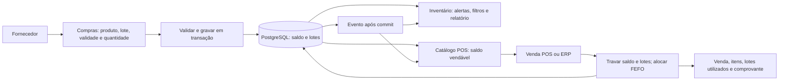
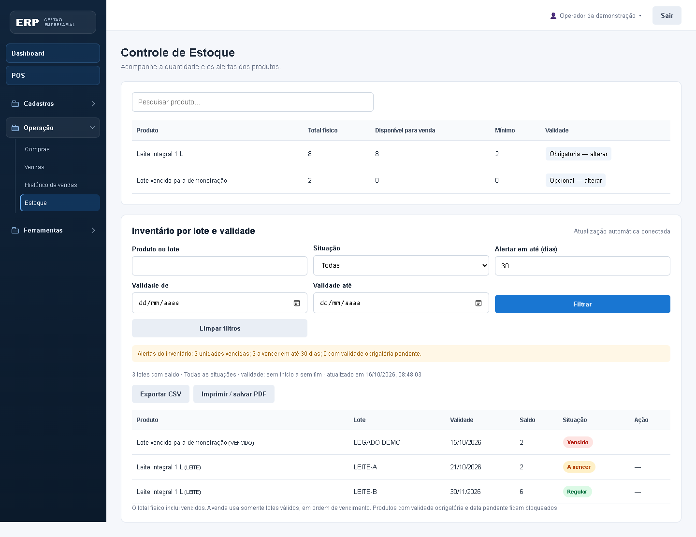
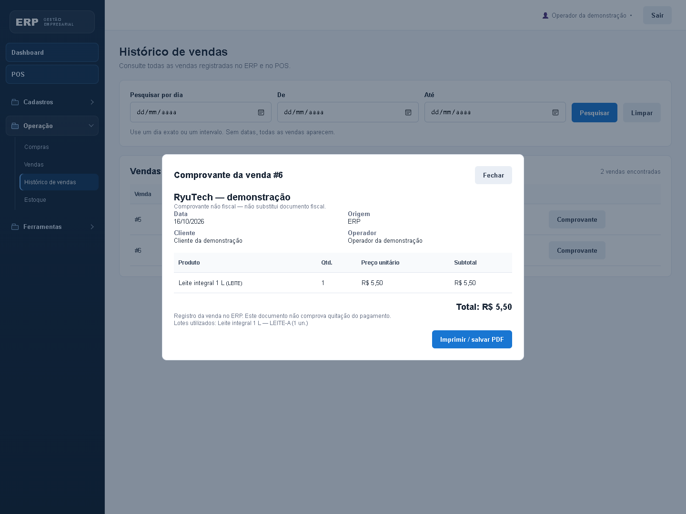

# Inventário integrado ao POS — entrega da rodada 2

Data da verificação técnica: 16/10/2026. Cliente da simulação: RyuTech.
Fonte do escopo: Guia Rodada 2 de ADM2, desafio 2, páginas impressas 12–13.
Estado: implementação e verificação técnica concluídas; aceite do representante e registros da apresentação dependem da simulação da equipe.

Este relatório preserva os requisitos e resultados da entrega acadêmica verificada em 16/10/2026. As instruções atuais para instalar e iniciar o ERP estão no [guia principal](../../README.md); o manual da contagem física está em [Inventário físico](../integracao/INVENTARIO-FISICO.md).

## Escopo e requisitos

| ID | Requisito e critério de aceite | Implementação/evidência |
|---|---|---|
| RF01 | Receber mercadoria por produto, quantidade, lote e validade. Perecíveis exigem lote e data. | Compras, DTO e `InventarioService.entrada`; teste de entrada e rollback. |
| RF02 | Consultar total físico e quantidade efetivamente vendável. | Estoque; vencidos e perecíveis sem validade não compõem o saldo vendável. |
| RF03 | Classificar lotes vencidos e a vencer. | Inventário; prazo de alerta de 0–365 dias, padrão 30. |
| RF04 | Filtrar inventário por produto/lote, situação e intervalo de validade. | Consulta, CSV e impressão/salvar PDF no navegador. Exportação usa os filtros aplicados. |
| RF05 | Baixar lotes automaticamente na venda, sem vender vencidos ou exceder o disponível. | ERP e POS usam `InventarioService.baixar`, FEFO, locks e transação. |
| RF06 | Preservar e identificar o estoque anterior. | Migração para lote legado; perecíveis sem data exigem regularização. Migração testada duas vezes. |
| RF07 | Atualizar caixas e inventário abertos após confirmação no banco. | SSE autenticado por empresa; consulta automática após evento/reconexão e na virada do dia. |
| RF08 | Consultar e imprimir comprovantes pelo histórico completo do ERP. | Histórico inclui ERP/POS, itens, total, dados disponíveis do pagamento POS e lotes consumidos. |
| RNF01 | Buscar atualização em menos de 2 s na simulação local. | Teste SSE e medição visual de 24 ms no navegador. É uma amostra local, sem SLA de produção. |
| RNF02 | Evitar venda parcial e dupla baixa no POS. | Rollback, locks, operação idempotente e testes de concorrência. |
| RNF03 | Isolar empresas. | Todas as consultas/alterações de lotes e comprovantes verificam a empresa do token. |
| RNF04 | Preservar os dados existentes e os fluxos do ERP. | Migração aditiva e repetível; produtos sem validade obrigatória continuam utilizáveis. |

Regras adotadas para a demonstração: validade de hoje ainda é vendável; data anterior a hoje é vencida. Datas de validade usam o dia de America/Fortaleza. FEFO consome primeiro a menor validade e depois o menor identificador; lotes sem validade permitida ficam no fim. Lotes vencidos permanecem no inventário físico e não podem ser vendidos. O estoque inicial não recebe validade fictícia. Uma validade já registrada não pode ser sobrescrita pela tela de regularização. Não se registra uma compra nova com validade já vencida; o lote antigo pode receber sua data real, mesmo vencida, ficando bloqueado.

## Processo e fluxo de dados

Dados: `estoque` mantém o total físico; `estoque_lotes` guarda saldo, identificação, validade, compra de origem e marca de legado; `venda_lotes` registra a distribuição da venda entre lotes. A soma dos saldos dos lotes acompanha o saldo físico. Entrada e saída atualizam ambos na mesma transação. O saldo anterior é migrado sem duplicação. Saldos novos criados por integrações antigas também são reconciliados como legado sob lock.

Design: a tela de Compras acrescenta lote e validade nas linhas; o cadastro de produto oferece validade obrigatória; Estoque mostra saldos físicos/vendáveis e a configuração, seguido do relatório por lote. O histórico do ERP abre comprovante em diálogo com botão de impressão. O histórico resumido do POS conserva as últimas 50 vendas POS.

## Manual de uso

1. Entre no ERP. Em **Cadastros → Cadastrar produto**, marque o controle de validade como obrigatório para perecíveis. Para produtos existentes, use **Operação → Estoque → Validade → alterar**. Ativar o controle bloqueia saldo sem data até a regularização.
2. Cadastre um fornecedor e abra **Compras**. Selecione produto, preencha quantidade inteira, lote e validade. Cada linha representa uma entrada de lote; o mesmo produto pode aparecer em linhas com lotes diferentes. Finalize a compra.
3. Abra **Estoque**. Compare total físico e disponível para venda. Observe o quadro de unidades vencidas, a vencer e com validade pendente. Altere o prazo de alerta e clique **Filtrar**.
4. Para um saldo antigo sem data, clique **Informar validade**, confira a embalagem e registre lote e data reais. A aplicação aceita a situação real de um lote antigo vencido e o mantém bloqueado. Não use essa ação para prolongar a validade de uma mercadoria.
5. Pesquise produto/lote ou escolha situação e intervalo; clique **Filtrar**. Use **Exportar CSV** ou **Imprimir / salvar PDF** para gerar o relatório filtrado. **Limpar filtros** volta à consulta geral.
6. Mantenha Estoque e POS abertos. Venda um produto no POS ou no ERP. O servidor baixa os lotes válidos automaticamente; o saldo das telas conectadas muda após o commit. Não há reserva de estoque em vendas guardadas.
7. Em **Operação → Histórico de vendas**, pesquise datas ou deixe-as vazias. Clique **Comprovante** e depois **Imprimir / salvar PDF**. Comprovantes do ERP registram a venda e não presumem pagamento; os do POS mostram o recebimento confirmado pelo operador. Nenhum deles substitui documento fiscal.
8. Se aparecer erro de conexão, aguarde reconexão e confira o estado exibido. O sistema exige conexão para concluir vendas. Não repita uma venda POS com outra operação quando houver confirmação pendente; use a verificação da mesma venda.

## Plano de testes e resultados

Banco utilizado: PostgreSQL temporário, independente da base configurada para uso normal.

| Cenário | Resultado técnico em 16/10/2026 |
|---|---|
| Venda POS grava itens, recebimento, saldo e movimentação | Aprovado |
| Reenvio da mesma operação e reenvios concorrentes | Aprovado; uma venda/baixa |
| Falha no último item | Aprovado; rollback integral |
| Produto/comprovante de outra empresa | Aprovado; acesso negado |
| Mudança de preço, quantidade inválida, pagamento não confirmado | Aprovado; rejeição |
| Dois caixas disputando o saldo | Aprovado; sem venda acima do disponível |
| Evento de estoque após commit em menos de 2 s | Aprovado no ambiente local |
| Histórico completo com mais de 50 vendas e datas | Aprovado |
| Estoque exatamente zero | Aprovado; sem venda ou lançamento financeiro |
| FEFO com lote que vence hoje e lote vencido | Aprovado; vencido preservado, baixa na ordem correta |
| Compra perecível sem lote/data ou com validade vencida | Aprovado; rejeição sem alteração parcial |
| Venda ERP com lotes e dados do comprovante | Aprovado |
| Regularização de legado e isolamento entre empresas | Aprovado; data definida uma única vez |
| Alertas e limites do prazo de alerta | Aprovado |
| Migração repetida preservando saldo anterior | Aprovado; sem duplicação |

Execução automatizada: `mvn test` / `mvn package`, 17 testes de integração. Resultados detalhados ficam em `target/surefire-reports/` após cada execução.

A verificação de navegador em `src/test/browser/inventario.cjs` cobre compra com dois lotes, opções sem duplicação, alertas, atualização visual automática, CSV, acionamento e estilos de impressão, venda ERP, comprovante, layout móvel e erros JavaScript. O resultado persistido e as imagens estão em `evidencias/`. O acionamento de impressão e seu layout foram verificados; a seleção de uma impressora física e o salvamento do PDF são feitos no diálogo do navegador pelo usuário.

## Implantação simulada e monitoramento

Foi iniciada uma instância local pela classe de teste `PosBrowserServer`, em `127.0.0.1:18765`, usando PostgreSQL descartável. Ela executa o mesmo backend e os arquivos estáticos empacotáveis da aplicação; os dados da demonstração são criados pelo roteiro automatizado. A evidência de navegador registra uma venda e a atualização visual do inventário em **24 ms**, sem erros JavaScript nessa execução. Não equivale a um ensaio de carga ou a uma certificação de disponibilidade.

Para reproduzir: use Java 21/Maven e execute `mvn test-compile dependency:build-classpath -Dmdep.outputFile=target/browser-classpath.txt`. No PowerShell, leia esse arquivo para `$dependencias` e execute `java -cp "target/test-classes;target/classes;$dependencias" com.erp.PosBrowserServer`. Com Node e Playwright instalados, execute em outro terminal `node src/test/browser/inventario.cjs`; `PLAYWRIGHT_MODULE` pode indicar a instalação do Playwright. O navegador padrão é Edge; `BROWSER_CHANNEL` permite selecionar outro canal instalado. O roteiro usa exclusivamente a porta local de teste e recria suas próprias contas no banco descartável.

Na implantação normal, faça backup e use o procedimento do README principal. O schema aplica a migração na inicialização. Confira os saldos antigos e classifique os perecíveis antes do uso. Para monitorar a demonstração, mantenha POS e Estoque abertos, observe o estado de conexão e registre a latência ao repetir vendas. O canal SSE atende uma instância da API; várias réplicas exigem distribuição dos eventos entre instâncias. Reiniciar o processo invalida as sessões de autenticação atuais.

## Aceite simulado, prazo e orçamento

A ficha abaixo deve ser preenchida na reunião com quem representar a RyuTech. Não há aceite ou feedback humano registrado automaticamente.

| Campo | Registro da equipe |
|---|---|
| Representante da RyuTech e data da reunião | Pendente |
| Confirmação das regras de validade/legado/FEFO | Pendente |
| Demonstração de entrada, venda, estoque zero e relatório | Roteiro pronto; apresentação ao representante pendente |
| Feedback e ajustes solicitados | Pendente |
| Aceite final e responsáveis | Pendente |
| Teto de orçamento e esforço efetivamente gasto | Não informado; equipe deve registrar |
| Cronograma acordado e evidência de cumprimento | Equipe deve confirmar; guia indica envio ao Caio até 25/10 |

Roteiro da apresentação: mostrar o fluxo acima; cadastrar/receber dois lotes do mesmo produto; exibir alertas; manter duas telas abertas e concluir venda; mostrar a baixa FEFO; tentar vender produto zerado e produto apenas vencido; exportar o relatório; abrir o comprovante pelo histórico; registrar feedback. As imagens em `evidencias/` já documentam a interface, e o resumo para a entrega está em `RESUMO.md`. A equipe deve reunir o material de vídeo/prints e realizar o envio solicitado pelo guia.
